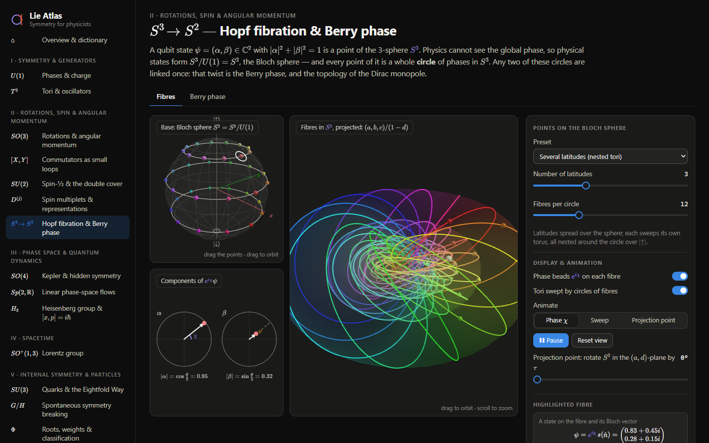
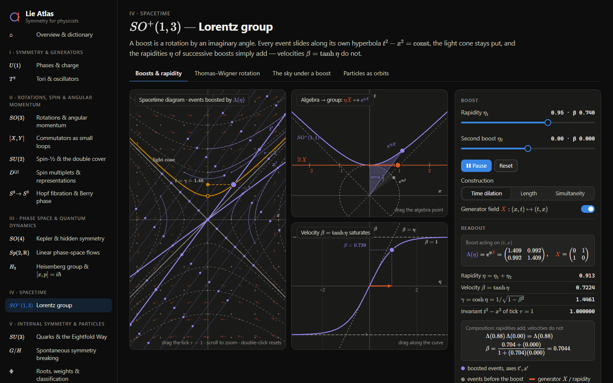
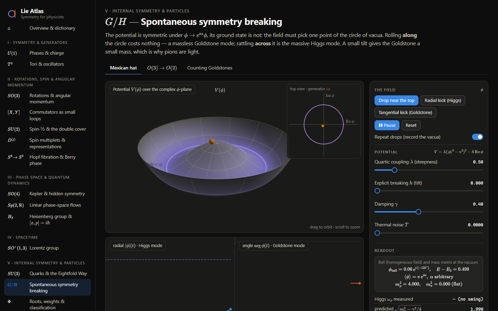

# Lie Atlas

**Interactive visualisations of Lie groups and Lie algebras, built for physicists.**

Lie Atlas is a web app for building physical intuition about continuous symmetry. Every page asks
the same question: *what does this group do to a physical system, and why should a physicist care?*
Rotate a spinor through 2π and watch its sign flip. Carry a qubit around the Bloch sphere and read
off its Berry phase. Compose two boosts and find the leftover Wigner rotation. Tilt the Mexican hat
and watch the Goldstone mode pick up a mass.



## What's inside

Fourteen pages in five chapters. Each one has live 2D/3D views you can drag, rotate and animate.
It also has a **Try this** list of guided experiments that set up a scenario and tell you what to
look for, and notes with the physics and the maths behind what you see.

| Chapter | Page | What you can do |
|---|---|---|
| **I · Symmetry & generators** | U(1): phases & charge | Wrap the line of generators onto the circle of phases with the exponential map; see why compactness forces integer charges. |
| | T²: tori & oscillators | Wind one-parameter subgroups around a torus: rational frequency ratios close up, irrational ones fill it densely. |
| **II · Rotations, spin & angular momentum** | SO(3): rotations & angular momentum | Explore axis–angle rotations, the π-ball with antipodes glued, and generators obeying $[J_i,J_j]=i\epsilon_{ijk}J_k$. |
| | Commutators as small loops | Go round a tiny loop and come back changed by $\epsilon^2[X,Y]$: rotations, Thomas precession, magnetic flux, curvature and the BCH formula. |
| | SU(2): spin-½ & the double cover | A 2π rotation flips the sign of a spinor and 4π restores it: Dirac's string trick, the Bloch sphere and Larmor precession. |
| | Spin multiplets & representations | Ladder operators, the Casimir $j(j+1)$, spherical harmonics rotated by Wigner D-matrices, and adding angular momenta. |
| | Hopf fibration & Berry phase | Each point of the Bloch sphere is a whole circle in S³. Linked fibres, the spin-½ Berry phase $\gamma=-\tfrac12\Omega$ and the Dirac monopole. |
| **III · Phase space & quantum dynamics** | Kepler & hidden symmetry | Rotations conserve $\vec L$; a hidden SO(4) conserves the Runge–Lenz vector, closes the orbits and explains the $n^2$ degeneracy of hydrogen. |
| | Sp(2,ℝ): linear phase-space flows | Quadratic Hamiltonians generate $\mathfrak{sp}(2,\mathbb R)$: oscillator, free particle and inverted oscillator; stability, parametric resonance and strong focusing. |
| | Heisenberg group & $[x,p]=i\hbar$ | Phase-space translations commute only up to a phase set by the enclosed area: Weyl relations, magnetic translations and the Aharonov–Bohm effect. |
| **IV · Spacetime** | Lorentz group | Boosts are hyperbolic rotations with additive rapidity; two non-collinear boosts leave a Wigner rotation. Aberration of the sky and Wigner's classification of particles. |
| **V · Internal symmetry & particles** | SU(3): quarks & the Eightfold Way | Weight diagrams: quark triplets, meson and baryon octets, the decuplet that predicted the Ω⁻, and colour singlets. |
| | Spontaneous symmetry breaking | The vacuum picks a point on the orbit G/H; broken generators become massless Goldstone modes, and a small explicit breaking gives them mass. |
| | Roots, weights & classification | Cartan generators as commuting charges and roots as the charges of ladder operators: Weyl reflections, Dynkin diagrams, grand unification and E₈. |

<p>
  
  
</p>

## Running it locally

You need [Node.js](https://nodejs.org) 20.19 or newer (22.12+ or 24 recommended). After cloning:

```bash
npm install
npm run dev        # → http://localhost:5173
```

Any current Chrome, Edge, Firefox or Safari works; the 3D views need WebGL 2. Light and dark themes
follow your system setting and can be switched in the app.

## Building and hosting

```bash
npm run build      # static site in dist/
npm run preview    # serve dist/ at http://localhost:4173
```

The build uses relative paths and hash-based routes (`#/su2`), so `dist/` works from any folder on
any static host, with no server configuration.

The repository includes a GitHub Actions workflow
([`.github/workflows/deploy.yml`](.github/workflows/deploy.yml)). On every push to `main` it runs the
tests, builds the site and publishes it to GitHub Pages. To turn it on, open **Settings → Pages**
and set **Source** to **GitHub Actions**.

## Conventions

The same conventions hold on every page:

* Units $\hbar = c = 1$. Generators are Hermitian: $U(\theta)=e^{-i\theta\,\hat n\cdot\vec J}$ with
  $[J_i,J_j]=i\epsilon_{ijk}J_k$. Where real (anti-Hermitian) generators appear, the page says so.
* Rotations are active and right-handed, and 3D views are z-up. The metric is $(+,-,-,-)$, and
  rapidity $\eta$ gives $v=\tanh\eta$.
* Spin-$j$ bases are ordered $m=j, j-1, \dots, -j$.
* Colours have fixed roles: orange for the algebra (generators, tangent vectors), violet for the group
  (finite transformations, orbits) and pink for brackets (commutators, curvature).

## Development

```
src/main.js           router, sidebar, home page, theme
src/registry.js       table of contents; pages are loaded lazily
src/core/             shared library: linear algebra, complex numbers, KaTeX, UI kit, 2D and 3D kits
src/modules/<id>.js   one page per module, with helpers and maths in src/modules/<id>/
tests/<id>.test.mjs   numerical tests per module (plain Node, no browser)
scripts/              test runners and the headless-browser smoke test
docs/ARCHITECTURE.md  module contract, page anatomy, design rules
```

**Tests.** `npm test` runs every numerical suite in plain Node, about 99,000 checks. They test the
physics against independent results: Weyl relations, Berry phases, Gauss linking numbers, Goldstone
counting, Runge–Lenz conservation and similar.

**Smoke test.** `npm run smoke` loads every page in a headless Chrome or Edge, collects errors and
saves screenshots to `screenshots/`. It needs Chrome or Edge installed; set `CHROME_PATH` if neither
is found. Add `--chaos` to fuzz every slider, button and canvas in every tab. It uses a single
browser and tests one page at a time.

```bash
node scripts/smoke.mjs hopf --chaos           # one page, with fuzzing
node scripts/smoke.mjs su2 --theme=light      # light theme
node scripts/smoke.mjs so3 --width=420        # phone-width layout
```

**Adding a page.** Copy [`src/modules/_template.js`](src/modules/_template.js), which uses every
core API and is reachable at `#/_template`. Register the page in
[`src/registry.js`](src/registry.js) and add a `tests/<id>.test.mjs` for its maths. The full
contract is in [`docs/ARCHITECTURE.md`](docs/ARCHITECTURE.md).

## Status

Every page is complete, loads without errors and passes the fuzz test, and the maths behind it is
covered by the numerical tests. An independent page-by-page review of the physics text is still to
come. If you spot a wrong sign, a misleading picture or a convention clash, please
[open an issue](../../issues).

## Contributing

Issues and pull requests are welcome. Before opening a pull request, run `npm test` and
`npm run smoke`, and keep to the conventions above.

## Acknowledgements

Built with [three.js](https://threejs.org), [KaTeX](https://katex.org) and [Vite](https://vite.dev).

## License

[MIT](LICENSE). Bundled dependencies keep their own licences (three.js and KaTeX are MIT).
